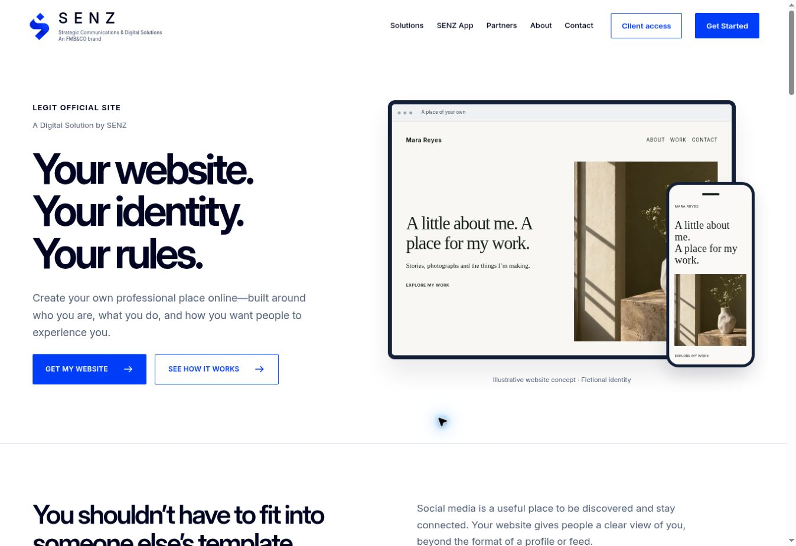

# Legit Official Site

A Digital Solution by SENZ. Your website. Your identity. Your rules.

This repository owns the campaign-domain redirect and service delivery specification. It deliberately contains no duplicate public landing page and no private customer application code.

| Responsibility | Canonical location |
| --- | --- |
| Product page, selection flow, public configuration and inquiries | `masinlocandher-max/Senz`, `/legit-official-site/` |
| Eligible licensed owner tools | Private `masinlocandher-max/Senzapp` repository |
| Acquisition domain | `legitofficialsite.com` and `www.legitofficialsite.com` |
| Permanent redirect destination | `https://senzpr.com/legit-official-site` |

The SENZ site currently canonicalizes to `www.senzpr.com`; its existing host and directory redirects may follow the acquisition redirect. Preserve that infrastructure. The one indexed product page is `https://www.senzpr.com/legit-official-site/`.

## Published product

The [SENZ product page](https://www.senzpr.com/legit-official-site/) is live. GitHub Pages published SENZ commit `4f423d28fd4554ae8d9fce073f5cd4bbf402d05c` successfully on 1 November 2026. A live browser verified the page, loaded assets, and professional-site questionnaire through to the prefilled inquiry form. [Release evidence](release-evidence.json) records checks and remaining boundaries.

## Redirect behavior

`redirect.mjs` is a dependency-free edge handler with a standard Fetch API interface. It returns HTTP 308 for GET/HEAD on the two exact acquisition hosts, directing every path to the product page. Bounded UTM campaign parameters are retained. Email addresses, tokens, arbitrary redirect targets and other query parameters are dropped. Customer subdomains are excluded. Other methods return 405 to avoid forwarding submitted data.

Run `npm run check` and `npm test`. These checks do not configure DNS or prove a live deployment.

## Deployment status and boundary

Implementation is ready for the existing DNS/edge provider. No provider was identified or authenticated for this newly acquired domain during this change. The redirect is **not verified live**. No DNS records, nameservers, email records, renewal settings or hosting accounts were changed.

Before enabling it, inspect the actual DNS zone, registrar forwarding and certificate coverage. Export the existing records. Prefer a provider-native permanent redirect when it can express the same exact-host rule; otherwise attach this handler to these two hosts on the existing edge account. Do not redirect `*.legitofficialsite.com`: that would capture future customer websites. Do not move SENZ hosting or use GoDaddy.

Validate HTTP and HTTPS for apex and www, direct and campaign paths, TLS coverage, final product content, and a sample UTM query. Check that existing MX, TXT, CAA, SPF, DKIM and DMARC records remain intact. Keep the previous edge rule as rollback evidence. DNS records alone cannot create an HTTP path redirect.

Pricing and capability availability are controlled in the canonical SENZ configuration. This repository is not a checkout, subscription provider or separate company.
